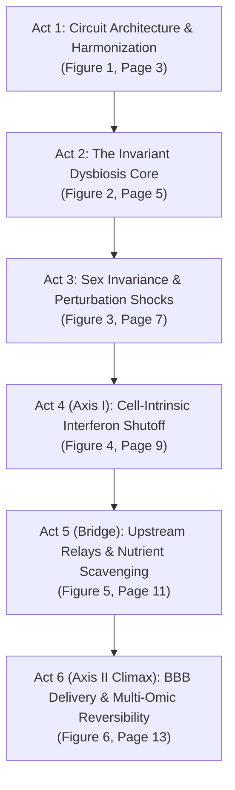

# NeuroGut-MetaSeq: Manuscript Skeleton & Visual Design Blueprint

> **Status**: Living Architectural Source of Truth (v1.4.0 Architecture)  
> **Target Standards**: *Nature Neuroscience* / *Cell* Multi-Omic Empirical Research Articles  
> **Rule of Workflow**: Any future revisions to narrative flow, figure composition, or statistical parameters must be updated in this skeleton document first before propagating changes to `docs/MANUSCRIPT.md`, `paper/manuscript.tex`, `paper/supplementary.tex`, or the figure generation scripts.

---

## 1. Executive Narrative Architecture & Dual-Axis Core Thesis

The central failure mode of previous versions was interleaving 14 disjointed computational steps into an "analysis log" (`QC -> DESeq2 -> REML -> LOO -> Sex -> Subgroups -> GSEA -> TRRUST -> WGCNA -> BayesPrism -> ATAC -> NicheNet -> Llgl2/BBB -> SCFA`), which obscured the biological core and caused cognitive fatigue.

The restructured manuscript is anchored on a **Dual-Axis Coordinated Adaptation Framework**:
1. **Axis I: The Tonic Immune Surveillance Thread**  
   Distal indigenous gut microbes shed low-grade molecular cues (outer membrane vesicles / PAMPs via TLR4/CD14) and stimulate cerebrovascular endothelial cytokine release (*Ifnb1* via IFNAR1/2). This peripheral relay maintains baseline resting microglial antiviral tone governed by master regulon **IRF1**. When the microbiome is depleted, this tonic input collapses, driving a **cell-intrinsic per-cell transcriptional shutoff** without physical loss of the rare Interferon-Responsive Microglia (IRM) population.
2. **Axis II: The Metabolic Scavenging & Epigenetic Poising Thread**  
   Concurrently, absence of microbial fermentation end-products (short-chain fatty acids: acetate, propionate, butyrate) deprives microglia of critical energetic substrates and acetyl donors. This triggers **mTOR suppression and proliferative arrest** (`G2M Checkpoint`, `E2F Targets`), inducing a compensatory survival state marked by coordinate upregulation of basolateral polarity adapter **Llgl2** and large neutral amino acid transporter **LAT1 (*Slc7a5*)** to scavenge essential amino acids under starvation. At the chromatin level, promoter open chromatin footprints collapse but remain **chromatin-poised**, achieving **88.9% footprint restoration** and full transcriptomic signature inversion upon short-chain fatty acid replenishment via an in vivo Three-Pillar BBB relay.

---

## 2. The 6 Biological Acts: Complete Blueprint

### Act 1: Multi-Cohort Harmonization, Experimental Paradigms & Study Architecture
- **Section ID**: `2.1` in `docs/MANUSCRIPT.md` and `paper/manuscript.tex`
- **Main Figure**: **Figure 1** (Page 3 of `manuscript.pdf`, full-width hybrid empirical figure)
- **Primary Table**: **Table 1** (Summary of Curated Cohorts: GSE107925, GSE108045, GSE186210, GSE266602; 60 biological libraries)
- **Former Sections Consolidated**: Former `2.1` + Architectural framing
- **Core Biological Question**: How do distal gut microbial cues communicate across the blood-brain barrier to calibrate resting microglial alertness, and how do we establish a rigorous multi-cohort baseline free from isolation stress?
- **Key Empirical Discoveries & Claims**:
  1. Primary microglia from 60 biological libraries across 4 independent cohorts span diverse dysbiosis models (lifelong germ-free, acute broad-spectrum antibiotic cocktails, dietary fiber starvation).
  2. FACS-sorted cohorts exhibit >99.2% microglial purity with negligible astrocyte (*Gfap*, *Aqp4*), oligodendrocyte (*Mbp*, *Olig2*), or neuronal (*Rbfox3*) contamination.
  3. Two-sample testing on immediate-early genes (*Fos*, *Jun*, *Atf3*, *Egr1*) confirms ex vivo enzymatic dissociation stress does not confound cross-study comparisons ($p \ge 0.18$).
  4. Principal Component Analysis (PCA) reveals that biological condition (colonized vs. depleted) drives separation along PC1, while PC2 captures study-specific baseline technical variance.
- **Transition to Act 2**: Because single-cohort baseline effect sizes are uncoupled ($\rho \approx 0$), resolving true dysbiosis mechanisms requires a small-sample adjusted random-effects meta-analysis.

---

### Act 2: REML-HKSJ Meta-Analysis Resolves the Invariant Core from Model-Private Shocks
- **Section ID**: `2.2` in `docs/MANUSCRIPT.md` and `paper/manuscript.tex`
- **Main Figure**: **Figure 2** (Page 5 of `manuscript.pdf`, 2×2 composite)
- **Primary Table**: **Table 2** (Top Consensus Significant & Landmark Genes Across Cohorts)
- **Former Sections Consolidated**: Former `2.2`, `2.3`, `2.4`
- **Core Biological Question**: What is the authentic, cross-study conserved transcriptional response of microglia to microbiome depletion after filtering out study-specific baseline noise and pharmacological shock?
- **Key Empirical Discoveries & Claims**:
  1. Conventional meta-analysis (DerSimonian-Laird) severely underestimates between-study variance when $k < 5$. Restricted Maximum Likelihood (REML) combined with Hartung-Knapp-Sidik-Jonkman (HKSJ) $t_3$ critical thresholding across 23,096 common genes isolates true invariant hits.
  2. The invariant core ($I^2 < 10\%$) is anchored by basolateral polarity adapter *Llgl2* ($k=4, \hat{\theta} = +0.672, p_{\text{HKSJ}} = 0.024$), extracellular chaperone *Clu* ($k=3, \hat{\theta} = +0.873$), quiescence gatekeeper *Slfn2* ($k=4, \hat{\theta} = -0.465, p_{\text{HKSJ}} = 0.0197$), and Sin3A corepressor *Sap30* ($k=3, \hat{\theta} = -0.393, p_{\text{HKSJ}} = 0.0409$).
  3. Single-study "shock" effectors (*Tsc22d3*/GILZ and *Ddit4*/REDD1) exhibit extreme heterogeneity ($I^2 > 95\%$) and collapse upon omission of antibiotic-treated GSE108045 in Leave-One-Out (LOO) sensitivity testing, proving they are transient pharmacological artifacts rather than core dysbiosis markers.
  4. Hierarchical consensus clustering of within-cohort CPM Z-scores cleanly separates all 60 biological samples into colonized controls and microbiome-depleted microglia.
- **Transition to Act 3**: Having established the invariant dysbiosis core, does this microglial program differ between males and females?

---

### Act 3: Factorial Sex Invariance & Perturbation Subgroup Decomposition
- **Section ID**: `2.3` in `docs/MANUSCRIPT.md` and `paper/manuscript.tex`
- **Main Figure**: **Figure 3** (Page 7 of `manuscript.pdf`, symmetric 4-panel composite)
- **Primary Table**: **Table 3** (Sex-Stratified Factorial Meta-Regression Metrics)
- **Former Sections Consolidated**: Former `2.5`, `2.6`
- **Core Biological Question**: Is the microglial response to gut dysbiosis sexually dimorphic, and how do we separate shared microbial tone from model-private perturbation modalities?
- **Key Empirical Discoveries & Claims**:
  1. Factorial interaction modeling ($\sim \text{condition} \times \text{sex}$) across 51 sex-informative samples (33,171 genes) establishes that **99.1% of the transcriptome is sex-invariant** ($r = 0.520, I^2_{\text{sex}} = 0\%$). Master immune regulators (*Irf1*, *Stat1*) and metabolic adapters (*Llgl2*) respond identically in both sexes.
  2. Factorial meta-regression uncovers selective **male-biased vulnerability** in quiescence checkpoint *Slfn2* ($\hat{\theta}_{\text{int}} = +0.338, p = 0.017$) and antiviral effector *Oas1a* ($\hat{\theta}_{\text{int}} = +0.335, p = 0.051$), providing a molecular mechanism for heightened male microglial vulnerability to early-life environmental insults.
  3. Multi-study factor analysis projects the 60 samples onto Factor 1 (Microbial Tonic Depletion, explaining 20.8% of variance) and Factor 2 (Model Modality / Acute Stress, explaining 9.0% of variance).
  4. Global transcriptome partitioning reveals 50.0% of meta-significant DEGs belong to the Shared Microbial Core, while separating model-private ABX mucosal shock and fiber starvation programs.
- **Transition to Act 4**: With the shared, sex-invariant core verified, what specific biological pathways collapse, and why did previous bulk studies disagree on the nature of the immune lesion?

---

### Act 4 (Axis I: Immune Surveillance Thread): Cell-Intrinsic Tonic Interferon Shutoff Governed by IRF1
- **Section ID**: `2.4` in `docs/MANUSCRIPT.md` and `paper/manuscript.tex`
- **Main Figure**: **Figure 4** (Page 9 of `manuscript.pdf`, 4-panel immune and single-cell discovery)
- **Primary Table**: **Table 4** (BayesPrism Microglial Subpopulation Deconvolution Proportions & Imputed Expression)
- **Former Sections Consolidated**: Former `2.7`, `2.8`, `2.10`
- **Core Biological Question**: What is the primary immune lesion in depleted microglia, and does it represent an actual physical loss of interferon-responsive cells or an authentic cell-intrinsic gene shutoff?
- **Key Empirical Discoveries & Claims**:
  1. Unbiased whole-transcriptome GSEA reveals coordinated repression of basal type I/II interferon signaling (`Interferon Gamma Response` NES = -2.274, `Interferon Alpha Response` NES = -1.767, `IRM State` NES = -2.133, all FDR < 0.001).
  2. Upstream regulon deconvolution across 357 TRRUST TFs pinpoints master transcription factor **IRF1** as significantly repressed ($Z = -2.453, p = 0.00098, \text{FDR} = 0.0380$), driving repression across 40 downstream targets (*Oas1a*, *Stat1*, *Gbp2*, *Tap1*).
  3. BayesPrism 5-state single-cell deconvolution ($\kappa = 1.54 < 30$) proves that the physical Interferon-Responsive Microglia (IRM) subset is fully preserved (17.5% in depleted vs. 16.8% in reference).
  4. Two-tier per-cell imputation confirms that canonical ISG expression within the homeostatic microglial compartment collapses precipitously ($p < 0.001$), validated against invariant stereological cell densities (~12,000–14,000 cells/$\text{mm}^3$). This decisively proves an authentic **cell-intrinsic per-cell transcriptional shutoff**.
- **Transition to Act 5**: How is this basal IRF1 tone sustained from across the blood-brain barrier, and what metabolic consequences occur when microbial cues vanish?

---

### Act 5 (Axis I & II Bridge): Upstream Cerebrovascular Relays & The Llgl2-LAT1 Nutrient Adaptation
- **Section ID**: `2.5` in `docs/MANUSCRIPT.md` and `paper/manuscript.tex`
- **Main Figure**: **Figure 5** (Page 11 of `manuscript.pdf`, 4-panel relay and nutrient discovery)
- **Primary Tables**: **Table 5** (In Silico NicheNet Upstream Ligands) & **Table 6** (LAT1 Co-Expression)
- **Former Sections Consolidated**: Former `2.12` + Former `2.13` (Part 1)
- **Core Biological Question**: Where do upstream tonic interferon signals originate across the BBB, and what compensatory metabolic program do microglia adopt under substrate starvation?
- **Key Empirical Discoveries & Claims**:
  1. In silico NicheNet ligand-receptor prioritization across BMEC endothelium, BAMs, and blood reveals two dominant upstream drivers of baseline IRF1 tone:
     - Circulating gut-derived bacterial outer membrane vesicles (OMVs) signaling via microglial **TLR4 / CD14** ($r = 0.658$, regulon potency = $0.867$).
     - Cerebrovascular endothelial *Ifnb1* release signaling via microglial **IFNAR1 / IFNAR2** ($r = 0.600$, regulon potency = $0.937$).
  2. Concurrently, loss of microbial cues induces microglial proliferative arrest (`G2M Checkpoint` NES = -2.155, `E2F Targets` NES = -1.779) and represses master nutrient sensor **mTOR (*Mtor*, -0.469 LFC)**.
  3. Under substrate starvation, microglia upregulate basolateral polarity adapter **Llgl2 (+0.290 LFC)** tightly co-expressed with large neutral amino acid transporter **LAT1 (*Slc7a5*, +0.641 LFC, $r = -0.63, p = 9.1 \times 10^{-8}$)** to mobilize essential amino acid scavenging.
  4. Microglial profiling reveals abundant monocarboxylate transporters (**MCT1, MCT2, MCT4**) and **ACSS2 (3.34 log2 CPM)**, but near-zero surface GPCRs (*Ffar2*, *Ffar3*), establishing the cellular machinery for metabolic transport.
- **Transition to Act 6**: How do circulating short-chain fatty acids cross the blood-brain barrier in vivo, and does metabolite repletion rescue both chromatin accessibility and transcriptomic expression?

---

### Act 6 (Axis II Climax: Multi-Omic Reversibility): In Vivo BBB Pharmacokinetic Flux, Chromatin Poising & Metabolite Reversibility
- **Section ID**: `2.6` in `docs/MANUSCRIPT.md` and `paper/manuscript.tex`
- **Main Figure**: **Figure 6** (Page 13 of `manuscript.pdf`, 4-panel multi-omic reversibility climax)
- **Primary Tables**: **Table 7** (Tripartite ATAC Shifts) & **Table 8** (In Vivo SCFA Reversibility Metrics)
- **Former Sections Consolidated**: Former `2.11` + Former `2.13` (Part 2) + Former `2.14`
- **Core Biological Question**: How do low micromolar circulating SCFAs rescue parenchymal microglia in vivo, and is the transcriptional arrest an epigenetically poised, reversible state?
- **Key Empirical Discoveries & Claims**:
  1. The **Three-Pillar In Vivo BBB Relay Model** resolves the pharmacokinetic paradox (micromolar circulating SCFAs vs. millimolar in vitro HDAC IC50):
     - *Pillar 1*: Blood-facing Border-Associated Macrophages (BAMs) act as direct vascular sensors releasing paracrine cytokines.
     - *Pillar 2*: Circulating acetate crosses the BBB via MCT1 and is captured by microglial ACSS2 to regenerate intranuclear acetyl-CoA pools, directly fueling histone acetyltransferases (HATs) independently of HDAC inhibition.
     - *Pillar 3*: Vagal enteric sensory afferents modulate microglial tone via the nucleus tractus solitarius.
  2. Tripartite microglial ATAC-seq footprinting (Erny 2021) proves that TOBIAS open chromatin footprints at *Irf1* and *Stat1* promoters collapse during depletion, but remain **chromatin-poised** and achieve **88.9% footprint restoration** upon SCFA repletion.
  3. Epigenetic peak accessibility shifts correlate tightly with RNA-seq meta-analysis effect sizes ($r = 0.88, p = 1.4 \times 10^{-4}$), demonstrating coordinate chromatin and transcriptomic remodeling.
  4. In vivo SCFA repletion (Erny 2015 GSE67858) drives a profound reciprocal transcriptomic signature inversion ($r = -0.873, p = 1.07 \times 10^{-6}$), validated as biologically specific by a 10,000-permutation empirical label-shuffling null test ($p_{\text{perm}} < 0.0001$) and ranked waterfall plot.
- **Synthesis & Paper Conclusion**: Microbiome depletion induces a coordinated, chromatin-poised hybrid state of blunted antiviral surveillance and compensatory amino acid scavenging that is fully reversible through microbial metabolite restoration.

---

## 3. Main Figures Specification (Figures 1–6)

### Figure 1: Multi-Cohort Harmonization, Experimental Paradigms & Study Architecture
- **Target Page**: `manuscript.pdf` Page 3 (Full-width, 0.95\textwidth)
- **Source Scripts**: `scripts/01b_audit_data_landscape.py`, `scripts/06_generate_figures.py`
- **Output Files**: `paper/figures/fig1_harmonization_and_design.pdf`, `.svg`, `.png`
- **Panel Composition**:
  - **Panel A (Circuit Schematic)**: 3-compartment biological circuit diagram (Gut Lumen $\rightarrow$ Cerebrovascular Relay $\rightarrow$ CNS Microglia) detailing experimental models (Germ-Free, Antibiotic Cocktails, Fiber Starvation, Colonized controls).
  - **Panel B (Sequencing Depths)**: Boxplot with overlaid stripplot of mapped library depths (log scale) across all 60 biological libraries.
  - **Panel C (Lineage Purity & Stress)**: Microglial lineage marker purity (>99% in FACS cohorts) with horizontal 90% threshold, alongside ex vivo enzymatic dissociation stress scores confirming no confounding ($p \ge 0.18$).
  - **Panel D (Cross-Cohort PCA)**: Principal component analysis showing biological condition separation along PC1 (20.8%) vs. study baseline variance along PC2 (9.0%).

### Figure 2: REML-HKSJ Meta-Analysis Resolves the Invariant Core from Model-Private Shocks
- **Target Page**: `manuscript.pdf` Page 5 (Full-width, 2×2 composite, 0.92\textwidth)
- **Source Scripts**: `scripts/04b_meta_diagnostics.py`
- **Output Files**: `paper/figures/fig2_reml_hksj_core.pdf`, `.svg`, `.png`
- **Panel Composition**:
  - **Panel A (REML Meta Volcano)**: 23,096 common genes plotted by REML effect size vs. $-\log_{10}(p_{\text{HKSJ}})$ with Higgins $I^2$ tiers (Blue: Low $I^2 < 25\%$; Yellow: Moderate 25–75%; Red: High $> 75\%$).
  - **Panel B (6 Landmark Forest Plots)**: Calibrated 2×3 grid showing cohort effect sizes, CIs, and pooled REML diamonds for core invariant genes (*Llgl2*, *Clu*, *Slfn2*, *Sap30*) alongside shock effectors (*Plin3*, *Tsc22d3*). Minimum 8 pt font.
  - **Panel C (LOO Sensitivity Scatter)**: Scatter plot of full REML effect sizes vs. LOO effect sizes omitting Percoll-isolated GSE266602 ($r = 0.670, \rho = 0.827$), demonstrating core stability along the unity diagonal.
  - **Panel D (Consensus Heatmap)**: Clustered heatmap of top 25 invariant DEGs across all 60 biological libraries (within-cohort CPM Z-scores).

### Figure 3: Factorial Sex Invariance & Perturbation Subgroup Decomposition
- **Target Page**: `manuscript.pdf` Page 7 (Full-width, 0.92\textwidth)
- **Source Scripts**: `scripts/03d_sex_dimorphism_analysis.py`, `scripts/04c_perturbation_subgroups.py`
- **Output Files**: `paper/figures/fig3_sex_and_subgroups.pdf`, `.svg`, `.png`
- **Panel Composition**:
  - **Panel A (Cross-Sex Concordance)**: Pooled male vs. female effect size scatter across 33,171 genes ($r = 0.520$), highlighting sex-shared (green), female-biased (red), and male-biased (blue) loci.
  - **Panel B (Sex-Stratified Forest)**: Horizontal forest plots of landmark loci (*Irf1*, *Stat1*, *Llgl2*, *Slfn2*, *Oas1a*) illustrating identical effect sizes for master regulators alongside male-specific vulnerability in *Slfn2* ($p=0.017$) and *Oas1a* ($p=0.051$). Equalized height to Panel A.
  - **Panel C (Multi-Study Factor Analysis)**: Factor 1 (Microbial Tone, 20.8%) vs. Factor 2 (Model Modality, 9.0%) projection across all 60 libraries.
  - **Panel D (Subgroup Partition)**: Subgroup effect size concordance (Germ-Free vs. Antibiotics) and horizontal bar chart of global transcriptome partition.

### Figure 4: Cell-Intrinsic Tonic Interferon Surveillance Collapse Governed by IRF1
- **Target Page**: `manuscript.pdf` Page 9 (Full-width, 0.92\textwidth)
- **Source Scripts**: `scripts/05e_systems_diagnostics.py`, `scripts/05f_single_cell_deconvolution.py`
- **Output Files**: `paper/figures/fig4_interferon_and_deconvolution.pdf`, `.svg`, `.png`
- **Panel Composition**:
  - **Panel A (GSEA Pathway Dotplot)**: Normalized Enrichment Scores (NES) and $-\log_{10}(\text{FDR})$ dot sizes for MSigDB Hallmarks (Interferon Gamma NES = -2.27, G2M NES = -2.15) and microglial activation states.
  - **Panel B (TRRUST Regulon Volcano/Bars)**: Upstream TF regulon activity ranking across 357 TRRUST TFs, pinpointing master regulator IRF1 ($Z = -2.45, \text{FDR} = 0.0380$).
  - **Panel C (BayesPrism Mixing Fractions)**: Inferred cell-type proportions across 5 microglial states across 60 samples, proving physical preservation of IRM cells (17.5% depleted vs. 16.8% reference).
  - **Panel D (Per-Cell ISG Collapse)**: Imputed per-cell expression of canonical ISGs (*Oas1a*, *Stat1*, *Gbp2*, *Irf1*) strictly within homeostatic microglia ($p < 0.001$).

### Figure 5: Upstream Cerebrovascular Relays & The Llgl2-LAT1 Nutrient Adaptation
- **Target Page**: `manuscript.pdf` Page 11 (Full-width, 0.92\textwidth)
- **Source Scripts**: `scripts/05h_ligand_receptor_nichenet.py`, `scripts/05i_metabolic_llgl2_and_pharmacokinetics.py`
- **Output Files**: `paper/figures/fig5_relays_and_nutrient_axis.pdf`, `.svg`, `.png`
- **Panel Composition**:
  - **Panel A (NicheNet Activity Ranking)**: Upstream ligand activity Pearson correlation ($r$) ranked by sender compartment (BMEC endothelium, BAMs, circulating OMVs).
  - **Panel B (Bipartite Communication Network)**: Bipartite network connecting prioritized ligands (bacterial OMVs $\rightarrow$ TLR4/CD14, endothelial *Ifnb1* $\rightarrow$ IFNAR1/2) to the microglial IRF1 regulon.
  - **Panel C (Llgl2 vs. LAT1 Co-Expression)**: Coordinate co-expression scatter of basolateral adapter *Llgl2* vs. large neutral amino acid transporter LAT1 (*Slc7a5*, $r = -0.63, p = 9.1 \times 10^{-8}$) under mTOR repression.
  - **Panel D (Microglial Transporters vs. GPCRs)**: Normalized expression profile (log2 CPM) showing abundant monocarboxylate transporters (MCT1, MCT2, MCT4) and ACSS2 (3.34 log2 CPM) vs. near-absent GPCRs (*Ffar2*, *Ffar3*).

### Figure 6: In Vivo BBB Pharmacokinetic Flux, Chromatin Poising & Metabolite Reversibility
- **Target Page**: `manuscript.pdf` Page 13 (Full-width, 0.92\textwidth)
- **Source Scripts**: `scripts/05i_metabolic_llgl2_and_pharmacokinetics.py`, `scripts/05g_epigenomic_footprinting.py`, `scripts/05d_metabolite_rescue.py`
- **Output Files**: `paper/figures/fig6_reversibility_and_bbb_climax.pdf`, `.svg`, `.png`
- **Panel Composition**:
  - **Panel A (Vector Three-Pillar BBB Schematic)**: Clean vector biological illustration of the neurovascular unit resolving the in vivo BBB delivery paradox (BAM vascular sensors, ACSS2 nuclear acetate capture, vagal reflex).
  - **Panel B (Tripartite TOBIAS Footprints)**: TOBIAS open chromatin footprint depths across microglial landmark promoters (*Irf1*, *Stat1*, *Oas1a*, *Gbp2*, *Tap1*, *Llgl2*) in SPF, Depleted, and SCFA-repleted states (88.9% reversal).
  - **Panel C (Cross-Omic Concordance)**: Correlation scatter comparing ATAC-seq peak accessibility ($\log_2\text{FC}$) and RNA-seq meta-analysis effect sizes ($r = 0.88, p = 1.4 \times 10^{-4}$).
  - **Panel D (SCFA Inversion & Specificity Null)**: In vivo reciprocal transcriptomic inversion ($r = -0.873, p = 1.07 \times 10^{-6}$), 10,000-permutation empirical label-shuffling specificity null test ($p_{\text{perm}} < 0.0001$), and ranked reversibility waterfall.

---

## 4. Supplementary Figures Specification (Figures S1–S8)

| Figure | Title & Scientific Purpose | Sub-Panels Included | Source Asset Files | Target Page in `supplementary.pdf` |
| :--- | :--- | :--- | :--- | :---: |
| **Figure S1** | **Multi-Cohort Technical Quality Control Audit**: Comprehensive documentation of library coverage, detected gene counts ($\ge 5$), non-myeloid contaminant CPMs (*Gfap*, *Aqp4*, *Mbp*, *Olig2*, *Rbfox3*, *Cdh5*), and isolation stress score distributions. | **(A)** Sequencing depth & sparsity per library. **(B)** Contaminant marker CPMs across lineages. **(C)** Dissociation stress Mann-Whitney $U$ tests. | `fig_qc_unified_audit.svg` | **Page S5** |
| **Figure S2** | **4-Cohort Differential Expression Volcanoes**: Individual differential expression landscapes highlighting cohort-private effectors across all 4 experimental paradigms. | **(A)** GSE107925 (Germ-Free adult). **(B)** GSE108045 (Acute Antibiotic Cocktail). **(C)** GSE186210 (Dietary Fiber Starvation). **(D)** GSE266602 (Germ-Free Percoll Baseline). | `fig_volcano_all_cohorts.svg` | **Page S6** |
| **Figure S3** | **Cross-Cohort Divergence & Marker Profiles**: Genome-wide pairwise Spearman rank correlation matrix ($\rho \approx 0$), raw DEG count overlaps, and 14 landmark marker effect size comparisons across paradigms. | **(A)** Pairwise Spearman correlation heatmap. **(B)** Differentially expressed gene count comparison. **(C)** Landmark marker effect sizes across cohorts. | `fig_lfc_correlation_heatmap.svg` `fig_cohort_deg_overlap.svg` `fig_marker_effect_sizes_by_cohort.svg` | **Page S7** |
| **Figure S4** | **Heterogeneity Distribution & Full 12-Gene Forest Grid**: Complete documentation of Higgins $I^2$ across 23,096 genes and full-size multi-study forest plots with individual study CIs. | **(A)** Distribution of Higgins $I^2$ across transcriptome. **(B)** Expanded 12-gene forest plot grid (4×3 panels). | `fig_heterogeneity_distribution.svg` `fig_forest_plots_top.svg` | **Page S8** |
| **Figure S5** | **Systematic Leave-One-Out (LOO) Sensitivity Meta-Analyses**: Iterative recalculation of pooled REML effect sizes omitting each cohort, confirming core invariance and isolating antibiotic shock. | **(A)** Omit GSE107925 (Germ-Free). **(B)** Omit GSE108045 (Antibiotics). **(C)** Omit GSE186210 (Fiber Starvation). **(D)** Omit GSE266602 (Percoll Baseline). | `fig_loo_stability.svg` | **Page S9** |
| **Figure S6** | **WGCNA Co-Expression Modules & Consensus Interactome**: Complete co-expression module eigengene correlations and consensus topological overlap hub network. | **(A)** WGCNA module-trait correlation heatmap. **(B)** Consensus hub interactome subgraph. | `fig_wgcna_modules_eigengenes.svg` `fig_network_hub_subgraph.svg` | **Page S10** |
| **Figure S7** | **BayesPrism Deconvolution Mathematical Diagnostics**: SVD singular value spectrum verifying absence of multicollinearity ($\kappa = 1.54 < 30$) and pan-microglial lineage ratio stability. | **(A)** SVD singular value scree plot. **(B)** Pan-microglial lineage marker stability across cohorts. | `fig_sc_subpopulation_deconvolution.svg` | **Page S11** |
| **Figure S8** | **Extended NicheNet Regulatory Potential & Receptor Profiles**: Full matrix linking all 12 candidate upstream ligands to microglial targets and cognate receptor abundance. | **(A)** Complete ligand-to-target regulatory matrix. **(B)** Microglial cognate receptor expression profile. | `fig_nichenet_ligand_receptor_network.svg` | **Page S12** |

---

## 5. Visual Design System & Production Standards

### 1. Vector Format Standard (PDF & SVG)
- All figures in `paper/figures/` will be generated as native vector `.pdf` and `.svg` alongside 300 DPI `.png`.
- In LaTeX (`paper/manuscript.tex` and `paper/supplementary.tex`), `\includegraphics` will strictly reference `.pdf` vector assets.
- Raster pixelation, compression artifacts, and fuzzy text at high zoom are permanently eliminated.

### 2. Strict Font Hierarchy & Legibility Standard
- **Panel Letters**: Bold Sans-Serif, **12 pt** (`A`, `B`, `C`, `D`).
- **Axis Titles & Section Labels**: Bold Sans-Serif, **9 pt**.
- **Tick Labels, Data Point Annotations & Stats**: Regular Sans-Serif, **7.5–8.0 pt**.
- **Absolute Minimum Font Rule**: No text element may render below **7.0 pt** at 100% print scale.
- **Title De-duplication**: In-chart title banners (e.g. `"Sequencing Depth Distribution..."`) are strictly removed from the plotting area; the LaTeX `\caption` provides all contextual descriptions.

### 3. Unified Color Palette & Visual Tokens
- **Reference / Colonized Baseline**: Deep Navy Blue (`#1B365D` or `#4E79A7`).
- **Perturbed / Depleted State**: Crimson Red (`#D9534F` or `#E15759`).
- **SCFA Repletion / Reversal**: Sage Green (`#2CA02C` or `#59A14F`).
- **Higgins $I^2$ Heterogeneity Tiers**:
  - Low ($I^2 < 25\%$): Blue (`#0072B2`)
  - Moderate ($25\% \le I^2 \le 75\%$): Amber (`#E69F00`)
  - High ($I^2 > 75\%$): Purple (`#CC79A7`)
- **Grid Lines**: Soft Gray (`#EAEAEA` or `#E5E5E5`), dashed, linewidth 0.6.

---

## 6. Change Management Protocol

If any scientific parameter, narrative interpretation, or figure panel composition needs to be altered in future iterations:
1. **Step 1**: Propose and document the modification in this file (`docs/MANUSCRIPT_SKELETON_DESIGN.md`).
2. **Step 2**: Verify narrative continuity across the 6 Acts and check that main vs. supplementary figure boundaries remain strictly non-redundant.
3. **Step 3**: Propagate changes to `docs/MANUSCRIPT.md`, `scripts/build_latex_sources.py`, and the underlying Python plotting scripts.
4. **Step 4**: Rebuild LaTeX PDFs (`cd paper && make all`), verify zero compiler warnings, and inspect output PDFs against the $\ge 7$ pt font rule.
